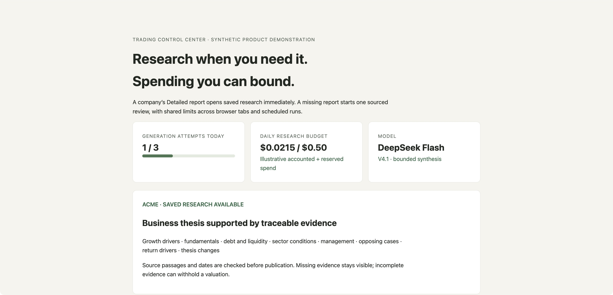

# On-demand research with a bounded daily budget

The image is a sanitized product demonstration using a fictional company and
illustrative figures. It is not a live report, provider invoice or investment
performance result.

## Problem

A reader opening a company's detailed report reached an empty panel with a
terminal command. Creating reports on demand would remove that friction, but
multiple tabs, retries and scheduled work could also multiply API spending.

## Product decision

Reuse saved research first. A missing report starts one background review and
shows progress, failures and an explicit retry. Browser requests, CLI work and
the weekly schedule share a limit of three hosted generation attempts or $0.50
per Eastern calendar day. The interface shows accounted and reserved spend.

Use DeepSeek V4.1 Flash for new hosted reports. Separate a fixed number of web
searches from one bounded synthesis call so the maximum request cost can be
reserved before sending it. Keep the existing business, growth, fundamentals,
debt, sector and opposing-case methodology, with dated source passages and
visible evidence gaps.

## Guardrails

- Duplicate clicks share work. A company-data redraw cannot lose or duplicate
  the creation request.
- Durable reservations prevent concurrent requests from spending the same
  remaining allowance. Ambiguous failures retain their reservation.
- Failures consume an attempt, preventing unbounded retry loops. Missing
  credentials detected before starting a job consume no new attempt.
- Source snippets cannot stand in for retrieved document text. Failed research
  is not presented as a successfully sourced report.
- Cached reads are free. Credentials are entered through hidden local input;
  other account and research features are outside this feature's daily limit.

## Outcome and validation

The missing-report workflow now reaches a visible creation, progress, report
or actionable failure state. The affected Python suite passed 469 checks;
JavaScript checks covered duplicate prevention, redraws during status/create,
cached reports and all 41 console entry points. The live company request
stopped because the local service had no DeepSeek key configured; no paid API
request was sent. Provider output quality remains unverified for that request.
