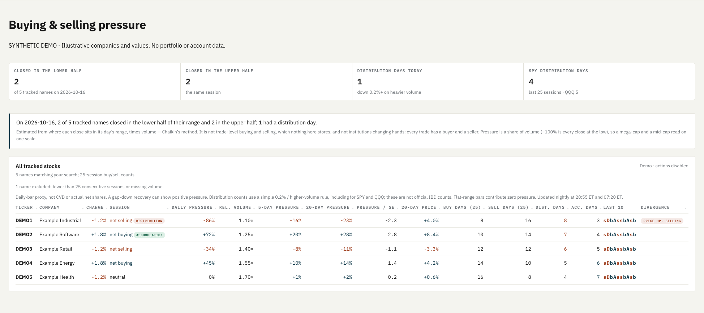

# Buying and selling pressure: make the estimate explicit

**Problem.** A stock can fall for a day while closing near its high. Calling
both observations “net selling” hides the difference between price movement,
bar-based pressure and actual trade flow. Monitoring many stocks compounds
that ambiguity.

**Product decision.** Put daily pressure, daily price change, 5/20-session
pressure, relative volume and 25-session buy/sell counts in one searchable
view. Offer ranked lists for discovery and an all-stock view for direct lookup.
Keep the measurement explanation above the numbers.

**Guardrails.** Label the data as a daily-bar proxy, never CVD or institutional
ownership flow. Require comparable session windows; disclose missing or
incomplete histories; show stale-data warnings. Distribution counts are a
simplified price-volume screen, not official IBD counts. Divergence is a
descriptive filter, not proof of statistical significance. No trading decisions
or orders are automated by this feature.

**Outcome.** The research workflow now supports both cross-stock discovery and
single-stock inspection without switching between disconnected indicators.
The implementation includes a scheduled refresh and regression checks for data
gaps, invalid volume, stale snapshots, search and failure states. No investment
performance improvement is claimed.

All names and values in this screenshot are synthetic. No portfolio, account,
credential, private path, or proprietary source code is published.
