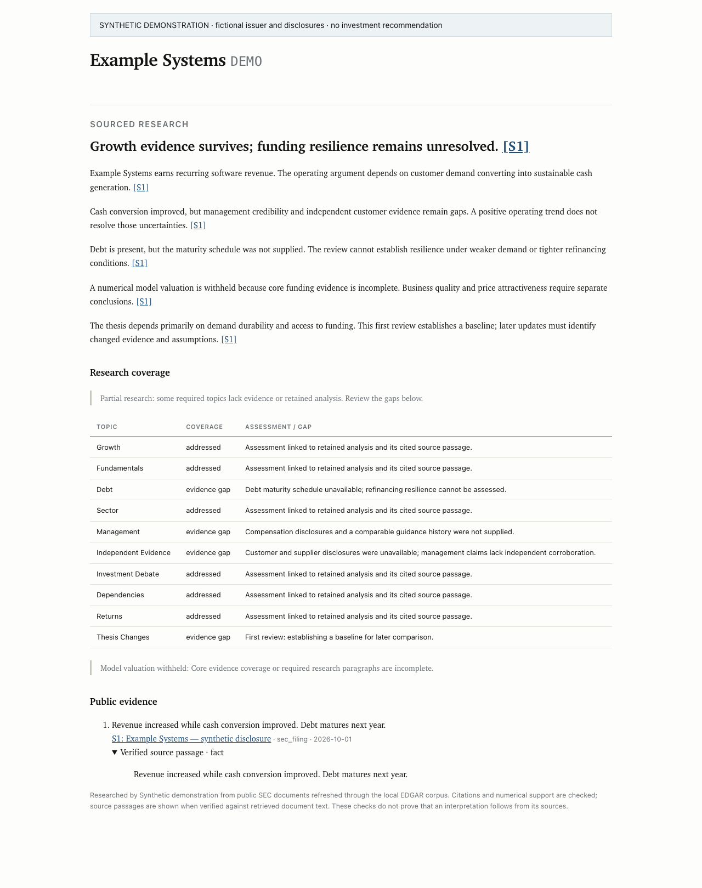

# Making incomplete investment research visible

The screenshot uses a fictional company, synthetic disclosures and illustrative
research. It demonstrates the report states, not a live model result or an
investment recommendation.

## Problem

A fluent stock thesis can hide incomplete research. A model can cite a real
filing while making an unsupported claim, omit refinancing exposure, or lose a
required paragraph during validation while retaining a confident valuation.
Changing the writing prompt alone does not make those failures visible.

## Product decision

Organize the research around the company's economics: growth, fundamental
quality, funding and sector conditions. Extend the review to management
credibility, independent evidence, the central investment debate, shared
dependencies, return requirements and changes since the prior thesis.

Give each topic an explicit evidence assessment or gap linked to retained
analysis. Preserve useful partial research, show the missing evidence, and
withhold the model valuation when core coverage or required paragraphs fail.
Store the sourced narrative so the next review can explain changed evidence and
assumptions rather than silently replacing its argument.

## Guardrails

- Check short quoted passages against retrieved document text. A factual
  evidence claim must occur in that passage; inferences must be labelled.
- Keep missing, zero and negative financial observations distinct.
- Use appropriate debt/capital analysis for each business type and distinguish
  contingent exposures from funded obligations.
- Check coverage after rejecting unsupported paragraphs. A missing funding
  analysis cannot leave a model rating behind.
- Treat prior research as dated context, excluding the prior structured target
  and rating from the comparison input.
- Make the limits explicit: citation, passage and coverage checks establish
  traceability, not proof that a financial interpretation is correct. The
  numerical model's calculations still require separate review.

## Outcome and validation

The operator can see what the research supports, what remains unknown and why
a model valuation was withheld. The affected regression suite passed **248
checks**, including synthetic cases for mixed semiconductor/software businesses,
banks, cyclicals, pre-profit companies, REITs and software dilution. These cases
exercise software safeguards, not model investment skill.

A separate review rubric assesses generated research against business-specific
failure cases. The live generation retry remained unavailable because of a
provider billing error; no improvement in live model quality or investment
performance is claimed. The existing published company review was preserved.
