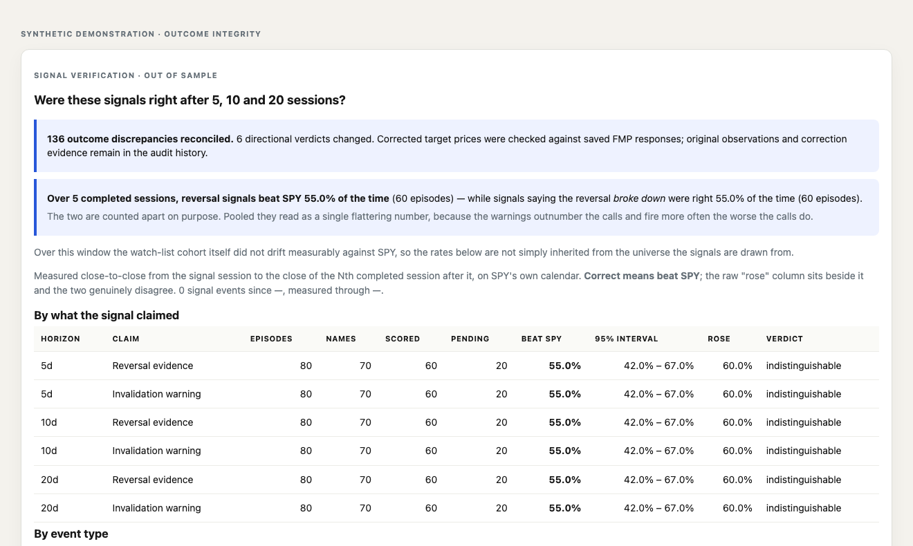

# Correcting signal outcomes without erasing history

The screenshot uses synthetic performance figures and no positions or account
information. The correction counts illustrate the completed reconciliation.

## Problem

A daily bar can have yesterday's date while still containing a quote collected
yesterday morning. Freezing that quote as a final close changes a research
outcome when the real closing price later arrives. Silently replacing the
original result makes the dashboard look consistent while removing its audit
trail.

## Product decision

Put data integrity before performance. Require an observation timestamp after
the market close, expire provisional price caches at the close, and distinguish
unmeasurable windows from losing signals. Add an explicit review path that
preserves the first measurement and appends the accepted correction and its
evidence. Display unresolved discrepancies or reviewed correction counts above
the return tables.

## Guardrails

- Normal scans and report rebuilds cannot accept corrections automatically.
- A review checks archived response hashes, observation times and target prices.
- Direction, signal prices, dates and benchmark changes require separate review.
- Conflicting evidence or inconsistent verdicts abort the entire review batch.
- Subsequent price changes raise new discrepancies against the reviewed values.
- Missing original vendor responses are recorded as evidence gaps.

## Outcome

The local audit reconciled **136 outcomes**, with **six directional verdict
changes** and **zero unresolved discrepancies**. Every original outcome row
remained unchanged. The 81 affected stock/date prices agreed with two later
vendor captures each; original response captures were recovered for 68 of those
81 prices. The other 13 retained an explicit evidence gap about their initial
acquisition state.

The focused regression suite passed **129 checks**, and the served verification
view rendered the reconciliation notice with no browser errors. These checks
establish data-handling behavior and traceability; they do not establish an
investment strategy's profitability.
